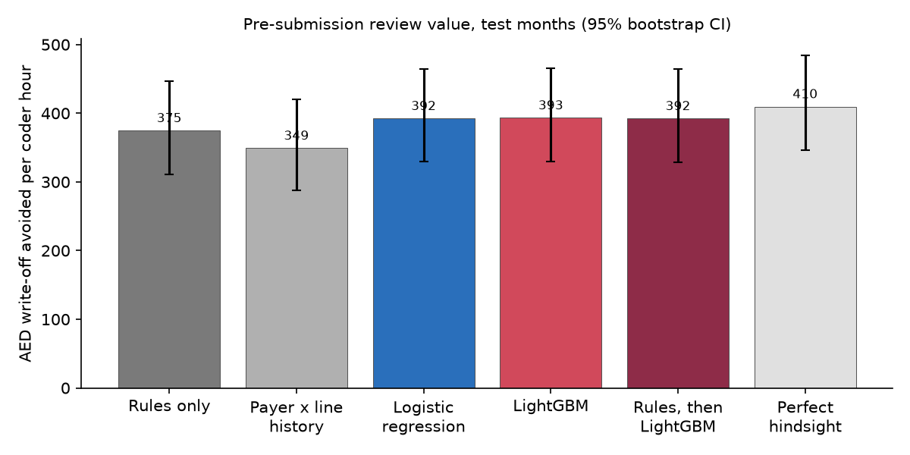
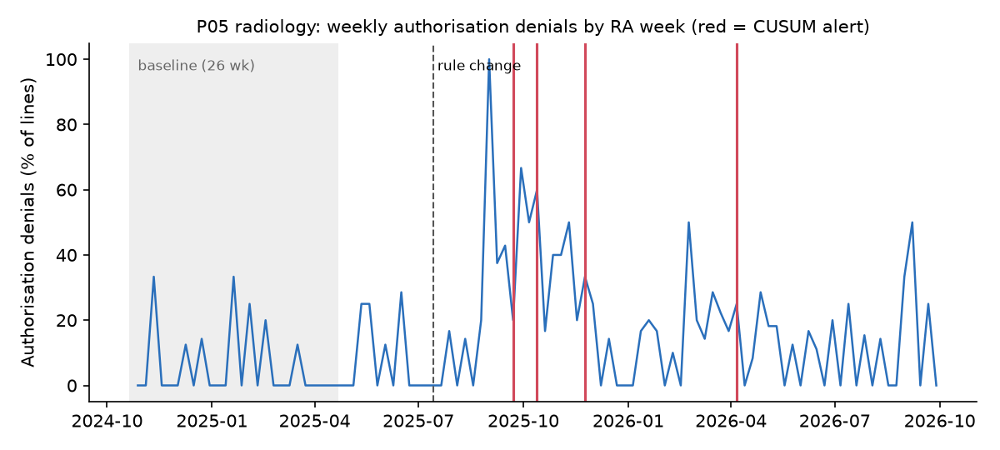

# DenialGuard: Claims Denial Analytics for UAE Medical Insurance

Denial-prevention analytics on simulated UAE hospital claims: a SQL revenue-cycle KPI layer, a rule-based claim scrubber vs machine learning measured in AED recovered per coder hour, payer change detection, and a two-page Power BI dashboard.

> **Data honesty:** claims are **simulated** using the published DHA eClaimLink field structure (NPHIES mapping note in [`docs/data_dictionary.md`](docs/data_dictionary.md)). Code sets and edit rules come from real public sources listed in [`data/reference/SOURCES.md`](data/reference/SOURCES.md), each marked verified or unverified. No result here describes real UAE or Saudi denial rates, and no real insurer or TPA is represented.

| AED recovered per coder hour: rules vs ML | Payer change detection |
|---|---|
|  |  |

## Problem

Every hospital already runs a claim scrubber. The questions a revenue-cycle management (RCM) director asks are:

1. Where is revenue leaking?
2. What does a model add on top of the scrubber?
3. Which claims should coders review today?
4. Which payer changed its behaviour, and how fast would we notice?

**Read the memo first:** [`reports/REPORT.md`](reports/REPORT.md). **Open the dashboard:** [`reports/powerbi/DenialGuard.pbix`](reports/powerbi/DenialGuard.pbix).

## Results (from `reports/metrics.json`; simulated data)

| What | Result |
|---|---|
| Data | 55,309 claims / 135,706 claim lines / 143,795 remittance rows; 6 fictional payers, 7 service lines, 24 months |
| Revenue leakage | 13.1% of net billed denied initially; 10.1% still lost after resubmission (AED 4.14M of AED 41.1M). 86% of initially denied AED is in avoidable categories. |
| Rules vs ML (time-based holdout, months 19 to 24) | Scrubber AUC 0.846 / AUC-PR 0.496 · LightGBM 0.902 / 0.794 · **best achievable 0.916 / 0.818** |
| **AED recovered per coder hour** (1 coder, 45 lines/day) | Rules **AED 375** (95% CI 311 to 447) · LightGBM **AED 393** (330 to 465) · uplift **+AED 19 (CI +11 to +28)**, about 5%, at every capacity tested. **ML adds little over a good rule set.** |
| Payer change detection | The planted authorisation change was caught 10 weeks after it took effect (3 weeks after the first denied remittance arrived), at 0.35 false alarms a month. A naive "rate doubled" rule raised 2.1 a month. |
| Payer scorecard | One payer settles only 37% of claims within the 45 days set by Dubai's PD-05-2025 directive (median 55 days, AED 30K late-payment fees due). Mix-adjusted denial rates range from 0.88× to 1.19× expected. |
| Answer key (opened last) | **5 of 6** planted effects recovered. The miss, a poorly documenting doctor ranked 4th, was masked by a facility effect; the memo explains it rather than tuning it away. |
| Data quality | 16 validation checks found every planted export problem (288/288 duplicate rows, 136/136 bad amounts, 136/136 amount mismatches, 28/28 bad dates). |
| Power BI | 2 pages on an 8-table star schema (3 facts, 5 dimensions) with 25 DAX measures. **274 of 274** DAX values match the SQL results ([`measure_check.csv`](reports/powerbi/measure_check.csv)). |
| Reproducibility | `python -m src.run_all` rebuilds everything in about 75 seconds. Two full runs agree on all 713 metrics. 39 tests pass. |

Because the simulator knows each line's true denial probability, the report can show the **best achievable** AUC and Brier score next to each model, not just the model's own score.

## Dashboard

- **RCM Overview:** KPI cards for net billed, initial and final denial rates, avoidable share, clean claim rate and median days to payment. Also denied AED by month, revenue lost by denial category, a service line × payer denial-rate matrix, and A/R days at month-end. Slicers for date, payer, service line and facility.
- **Payer Scorecard:** each payer's actual vs mix-adjusted expected denial rate, PD-05-2025 payment timeliness and late-payment fees, the weekly authorisation-denial trend with change-detector alerts, and median days to payment by month.

## What's in it

| Step | Code | Output |
|---|---|---|
| Real reference data | `src/reference.py` | CMS ICD-10-CM FY2027, Medicaid NCCI procedure-to-procedure edits (2026-10-01), Medicare MUE table (Q4 2026). Downloaded at run time and git-ignored, because CPT codes are AMA-licensed. |
| Simulator | `src/generator.py`, `config/sim.yaml`, `config/catalog.yaml` | Line-level claims, prior authorisations, remittance rounds (initial, resubmission, reconciliation), partial payments, planted effects, sealed answer key, planted export problems |
| Validation | `src/validate.py` | `data/clean/*.parquet`, `data/clean/data_quality.csv` |
| Rule scrubber | `src/scrubber.py` | 13 rules, each with a suggested fix: eligibility, authorisation, NCCI/MUE, invalid ICD, duplicate, timely filing, price, plan exclusion, benefit limit, medical necessity |
| **SQL KPI layer** | `sql/01_staging.sql` … `sql/05_series.sql`, [`sql/KPI_DEFINITIONS.md`](sql/KPI_DEFINITIONS.md), `src/build_db.py` | DuckDB star schema, KPI cube, leakage, PD-05-2025 timeliness, A/R days, mix-adjusted payer scorecard, weekly series |
| Models | `src/features.py`, `src/model.py` | Baseline, logistic regression, LightGBM; calibration and SHAP figures |
| Worklist | `src/worklist.py` | Daily review lists under a fixed coder capacity (blind to outcomes) |
| Change detection | `src/detect_change.py` | Binomial CUSUM on weekly authorisation denials; Gaussian CUSUM on days to payment; naive baseline |
| Drivers | `src/drivers.py` | Payer, facility and clinician cells vs peers with Benjamini-Hochberg correction; code-pair ranking |
| **Power BI** | `src/export_powerbi.py`, `reports/powerbi/` | Star-schema CSVs, [`MODEL.md`](reports/powerbi/MODEL.md), [`MEASURES.md`](reports/powerbi/MEASURES.md), [`LAYOUT.md`](reports/powerbi/LAYOUT.md), `expected_values.csv` (274 check values), `DenialGuard.pbix` and the Power BI Project source (`pbip/`) |
| Scoring | `src/score.py` | The **only** reader of the sealed answer key: performance ceiling, AED per coder hour with bootstrap CIs, detection lag, answer-key table |
| Memo | `src/report.py` | [`reports/REPORT.md`](reports/REPORT.md), with every number taken from `reports/metrics.json` |

**Tests:** KPIs in SQL vs a hand-calculated 20-line dataset; every scrubber rule on hand-written claims; generator reproducibility and planted mechanisms; validation finds every planted export problem; features are unchanged when outcomes are flipped (no leakage); only `score.py` reads the answer key; change detection; reference-file parsing.

## Source verification (details in `data/reference/SOURCES.md`)

| Source | Status |
|---|---|
| DHIC PD-05-2025 claims-management directive | **Verified text** (archived official PDF). Current status unconfirmed: the live link returns 404. |
| DHA GC 06/2018 denial-code updates | **Verified** (official circular) |
| Other eClaimLink denial-code descriptions | Secondary (HCX/Shafafiya-derived lists) |
| Shafafiya field names (DOH Abu Dhabi) | Verified for DOH; assumed identical for DHA eClaimLink |
| CMS NCCI PTP / MUE / ICD-10-CM files | **Verified** (downloaded, hashed, parsed) |
| Kuwait AFYA study (3.85% rejection rate) | Verified (sanity reference only) |
| NPHIES profiles | Unverified (mapping note only) |

## Limitations

- The claims are simulated. Results show how well the **method** works on data with known structure, not real denial rates or payer behaviour.
- The answer key is hidden from the code, not from the author, who wrote the generator and so knew the effect *types* (though not their sizes, targets or dates). The detectors are generic, and thresholds were fixed before scoring.
- NCCI/MUE are US Medicare/Medicaid edits, used as a realistic stand-in for UAE payers' private edit sets. The scrubber does not reproduce DHA's, NPHIES's or any payer's actual edit engine.
- The AED figures scale with the review assumptions in `config/review.yaml` (capacity, minutes per line, fix rates).
- The Power BI file reads the CSVs from absolute paths. After cloning, run `python -m src.run_all`, then repoint the sources (see `reports/powerbi/MODEL.md` §7).

## Future work

- Kitagawa decomposition, a mixed-effects payer model, and within-facility clinician comparison (the fix for the one missed effect).
- Kaplan-Meier / Cox time-to-payment models.
- A resubmission prioritisation model; sensitivity runs at other base denial rates.
- A pre-submission checker app, FHIR R4 `Claim`/`ClaimResponse` export, and CI.

## Run it

```bash
python -m venv .venv
source .venv/bin/activate        # Windows: .\.venv\Scripts\Activate.ps1
pip install -r requirements.txt

python -m src.run_all            # downloads CMS reference files on first run (~70 MB), then rebuilds everything
pytest                           # 39 tests
```

## Tech

Python, DuckDB (SQL), pandas, scikit-learn, LightGBM, SHAP, SciPy, matplotlib, pytest, Power BI (DAX, TMDL/PBIR project format).
