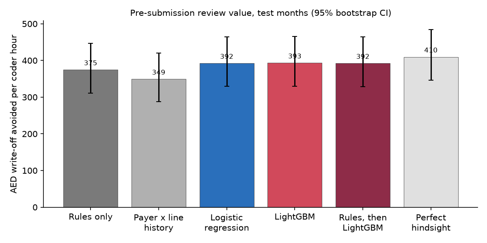
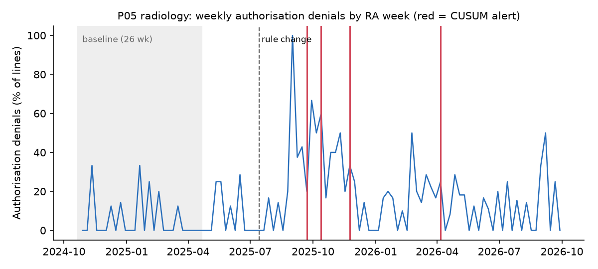

# Memo: claims denial review, simulated hospital group

> **Data honesty: claims are SIMULATED using the published DHA eClaimLink field structure (NPHIES mapping note in docs/data_dictionary.md). Code sets and edit rules come from real public sources listed in data/reference/SOURCES.md. No result describes real UAE or Saudi denial rates.**

**To:** RCM Director · **Re:** where revenue leaks, what to review first, which payer changed · **Data:** 55,309 claims / 135,706 claim lines, 6 payers, 7 service lines, service dates 2024-10-01 to 2026-09-30 (24 months)

## Three things to know

1. **We lose 10.1% of net billed revenue to denials after resubmission** (AED 4,141,231 of AED 41,121,950). The initial denial rate is 13.1% by value. 86% of initially denied AED sits in categories a pre-submission check can normally prevent. Three categories, medical necessity, authorisation and coding, make up 70% of the loss.
2. **The rule scrubber already does most of the work. The model adds a little, and the gain is real.** With one coder reviewing 45 lines a day, reviewing what the scrubber flags avoids AED 375 of write-off per paid coder hour. Adding a LightGBM risk score raises that to AED 393 (+AED 19, 95% CI 11 to 28, +5%). The gain holds at every capacity tested, but it is small. Fix the rule gaps first. The model's main job is to rank the 10,432 medical-necessity flags, of which only 20% are actually denied for that reason.
3. **Marina Health Partners TPA changed its prior-authorisation rules for radiology, and Dune Mutual Insurance has been paying late.** The change detector raised its alert 3 weeks after the first denial of the new kind reached us (10 weeks after the change itself), at 0.35 false alarms a month. Dune Mutual Insurance settles only 37% of claims within the 45 days PD-05-2025 requires (median 55 days) and owes us AED 30,334 in late-payment fees.

## 1. Where revenue leaks

| Denial category | Initially denied | Still lost after resubmission |
|---|---|---|
| Medical necessity | AED 1,621,326 | AED 1,083,328 |
| Authorisation | AED 1,363,608 | AED 1,052,274 |
| Coding | AED 1,074,453 | AED 781,980 |
| Non-covered | AED 479,879 | AED 420,842 |
| Eligibility | AED 323,687 | AED 316,659 |
| Duplicate | AED 206,333 | AED 205,905 |
| Timely filing | AED 202,935 | AED 193,602 |
| Price | AED 51,102 | AED 47,716 |
| Other | AED 81,823 | AED 38,926 |

By service line, the largest losses after resubmission are day surgery (AED 1,489,546), radiology (AED 1,110,190), physiotherapy (AED 579,406). Day surgery and radiology lose the most because each denied line is expensive.

Specific leaks found by the driver analysis (each cell tested against its peers, Benjamini-Hochberg q < 0.05, ranked by excess denied AED):

- **FAC-HH radiology, authorisation:** 10.9% of lines denied for authorisation vs 3.5% at the other facility, an excess of AED 369,631. The prior-approval step for high-cost imaging at this site is failing. Fix the process, not the claims.
- **Code pair 43239 + 43235:** 86 lines denied as bundled (PRCE-002), AED 250,980. This is a real CMS NCCI edit with modifier indicator 0, so the second code is never separately payable. It needs a coding rule and a word with the department, not resubmission.
- **Pearl Care TPA, physiotherapy, medical necessity:** 11.9% vs 4.6% at other payers for the same service line, an excess of AED 49,831. Take this to the payer with documentation examples.

## 2. What to review first, and what it is worth

Test months 19–24 of the simulation (37,874 lines). Models were trained on months 1–15 and tuned on 16–18 (time-based split). The coder reviews 45 lines per submission day (1 coder, 6 h/day, 8 min/line). 'Recovered' means write-off avoided: denied AED that would still have been lost after resubmission, multiplied by an assumed fix rate per root cause (`config/review.yaml`).

| Review policy | AED recovered per paid coder hour (95% CI) | Total recovered | Lines reviewed | Share of reviewed lines that were denied |
|---|---|---|---|---|
| Scrubber flags, largest first | 375 (311–447) | AED 568,859 | 5,845 | 61% |
| Payer × service-line history | 349 (288–420) | AED 530,012 | 8,981 | 17% |
| Logistic regression | 392 (330–465) | AED 595,643 | 8,981 | 40% |
| LightGBM | 393 (330–465) | AED 597,057 | 8,981 | 40% |
| Scrubber flags first, then LightGBM | 392 (328–464) | AED 595,498 | 8,981 | 42% |
| Perfect hindsight (ceiling) | 410 (347–484) | AED 621,850 | 8,981 | 35% |

- **Rules alone leave the coder idle 49% of the review time.** They flag fewer lines than capacity allows. Per hour actually spent reviewing, rules recover AED 730. That is the best yield per hour, but it leaves hours unused.
- **What the model adds over the rules, by true root cause:** medical necessity AED 20,184, eligibility AED 6,004, non-covered AED 221, authorisation AED 144, invalid diagnosis code AED 44, missing NCCI modifier AED 42. Most of it is better ranking of medical-necessity flags, plus members whose coverage the payer ended without telling us (retro-termination), which no rule can see.
- **Capacity sensitivity** (AED per paid coder hour):

| Lines/day | Rules | LightGBM | Uplift |
|---|---|---|---|
| 10 | 1,504 | 1,530 | 1.8% |
| 20 | 802 | 835 | 4.1% |
| 30 | 553 | 575 | 4.1% |
| 45 | 375 | 393 | 5.0% |

- **Ceiling:** at this capacity, perfect hindsight recovers AED 410 per hour. LightGBM reaches 96% of that, and rules alone 91%.

**Model quality on the test months vs the best any model could do** (the generator knows each line's true denial probability):

| Scorer | AUC | AUC-PR | Brier |
|---|---|---|---|
| Payer × service-line history | 0.600 | 0.186 | 0.1077 |
| Scrubber (any flag) | 0.846 | 0.496 | 0.0905 |
| Logistic regression | 0.901 | 0.793 | 0.0435 |
| LightGBM | 0.902 | 0.794 | 0.0435 |
| **Best achievable (true probabilities)** | 0.916 | 0.818 | 0.0396 |

LightGBM reaches 97% of the best achievable AUC-PR. Little ranking signal is left to find. The remaining denials are mostly random adjudication noise, which no model can predict. Calibration: `figures/calibration.png`. Drivers: `figures/shap_summary.png` (top SHAP features: n_scrubber_flags, dx_support, code, clinician_id, days_to_coverage_end).

## 3. Which payer changed, and when we would have known

Every week, for each payer × service line, the detector compares authorisation denials (by the week the remittance arrived) with that series' first 26 weeks, using a binomial CUSUM with a threshold fixed before scoring. It monitored 42 series for 76 weeks.

- **Marina Health Partners TPA began requiring prior authorisation for radiology codes that did not need it before** (effective 2025-07-14). The first denial of the new kind reached us on 2025-08-29. The CUSUM alerted in the week of 2025-09-22: **10 weeks after the change and 3 weeks after the first denied remittance.** Most of the delay is the payer's own turnaround.
- False alarms: 6 over the monitoring period (0.35 a month, on 5 series). A naive rule ("rate doubled vs the last 8 weeks") alerted 2 weeks earlier than the CUSUM, but raised 37 false alarms (2.1 a month). Nobody would keep reading those.
- What the change cost: 34 lines, AED 8,793 initially denied. 21 of those lines (AED 5,553) were submitted *after* the alert. Updating the scrubber's authorisation list when the alert fired would have caught them. The amount is small here because the newly covered codes are cheap, low-cost imaging. The same response time applied to a high-cost service line is what matters.
- **Dune Mutual Insurance slowed its payments from 2025-09-01.** A CUSUM on the weekly median days to payment flagged it 6 weeks later, with 0 false alarms on the other payers.

## 4. Payer scorecard

Expected rate = what the payer's denial rate (by value) would be if it denied each service line at the all-payer rate, given its own service mix.

| Payer | Type | Net billed | Initial denial rate (value) | Expected for its mix | Actual ÷ expected | Overturn rate | Median days to pay | Paid ≤ 45 days | Late-payment fee due | A/R days |
|---|---|---|---|---|---|---|---|---|---|---|
| Dune Mutual Insurance | insurer | AED 5,370,672 | 15.7% | 13.1% | 1.19 | 47% | 55 | 37% | AED 30,334 | 77 |
| Marina Health Partners TPA | TPA | AED 5,142,794 | 13.8% | 13.2% | 1.05 | 43% | 28 | 95% | AED 548 | 33 |
| Oasis Assurance | insurer | AED 7,779,400 | 13.2% | 13.0% | 1.02 | 49% | 30 | 92% | AED 1,178 | 35 |
| Falcon Health Insurance | insurer | AED 10,663,101 | 12.5% | 13.2% | 0.95 | 45% | 26 | 97% | AED 744 | 30 |
| Pearl Care TPA | TPA | AED 7,920,566 | 12.6% | 13.3% | 0.95 | 46% | 24 | 98% | AED 208 | 27 |
| Crescent Benefits TPA | TPA | AED 4,245,418 | 11.6% | 13.1% | 0.88 | 48% | 32 | 88% | AED 1,442 | 36 |

**Why the mix-adjusted rate matters:** a payer whose members mostly use high-denial services will show a high raw denial rate even if it treats each service exactly like the other payers. Here, Dune Mutual Insurance denies 1.19× what its mix explains, and Crescent Benefits TPA only 0.88×. Raise the gap in contract talks, not the raw rate. The raw rate invites the reply "look at your own case mix".

Hospital-wide: clean claim rate 73.7%, first-pass yield 78.8%, resubmission overturn rate 46.6%, median days to payment 29, A/R days 37.5 (mean of the last 12 month-ends), 86.1% of claims settled within 45 days. Late-submission fees we would owe under PD-05-2025: AED 10,015.

## 5. Did the analysis find what was planted? (answer key, unsealed last)

The generator planted six effects with sizes and dates drawn from hidden ranges. Only `src/score.py` reads the answer key, and a test enforces that. Detection rules and thresholds were fixed before scoring. **Recovered: 5 of 6.**

| Planted effect | How the pipeline looks for it | Result |
|---|---|---|
| P03 stricter on medical necessity for physiotherapy | payer x service-line driver ranking | found, rank 1 |
| FAC-HH misses prior auth on high-cost radiology | facility driver ranking | found, rank 1 |
| NCCI pair 43239+43235 billed by gastroenterology | code-pair ranking (PRCE-002 denials) | found, rank 1 |
| P05 starts requiring prior auth for radiology (2025-07-14) | binomial CUSUM on weekly authorisation denials | found, 10.0 weeks after the change |
| P04 slows payment from 2025-09-01 | CUSUM on weekly median days to payment | found, 6.0 weeks after the change |
| CLN-013 documents poorly (more medical-necessity denials) | clinician vs specialty peers ranking | **missed**, rank 4 |

**Why the miss:** the clinician ranking compares each doctor with same-specialty peers across *both* facilities. 2 of the 3 cells ranked above the planted doctor are radiologists at the facility with the authorisation problem, which is the facility effect showing up again at clinician level. The planted doctor ranked 4, just outside the top 3. Comparing clinicians within the same facility is the obvious fix. It was not applied after unsealing, because that would be tuning to the answer key.

**Data quality:** the validator ran 16 checks; planted export problems found: remittance duplicate rows 288/288; non-positive net amounts 136/136; gross != patient share + net 136/136; settlement before submission (claims) 28/28. 136 lines quarantined.

**Denials no rule can see** (test of the scrubber's blind spots): 302 eligibility denials from coverage the payer ended without telling us, 34 authorisation denials from the unannounced rule change, and 1,864 random adjudication denials.

## 6. Limitations (read before quoting any number)

- **The claims are simulated.** The results show how well the *method* works on data with known structure. They are not real UAE denial rates or real payer behaviour. All payer names are fictional.
- **The answer key is blind to the code, not to me.** I wrote the generator, so I knew the effect *types*, though not their sizes, targets or dates. The detectors are generic (every payer × line × category is tested), and thresholds were fixed before scoring.
- **The AED figures scale with assumptions:** review capacity, minutes per line and fix rates by root cause (`config/review.yaml`).
- **NCCI/MUE are US CMS edits** (the Medicaid PTP practitioner file and the Medicare MUE table, Q4 2026). UAE payers' own edit sets are not public.
- **PD-05-2025** was read from the archived official PDF (Wayback Machine, 8 Nov 2025). The live ISAHD link returned 404 on 11 Nov 2026, so confirm its current status with DHIC. Its timelines are applied to the whole simulated period, including the months before 16 Nov 2025.
- **Denial-code descriptions** are verified for GC 06/2018 codes. The others come from secondary sources (see `data/reference/SOURCES.md`).
- **The Power BI report** (`reports/powerbi/DenialGuard.pbix`) was checked by querying its DAX measures in Power BI Desktop: 274 of 274 check values from SQL matched (22 measures, unfiltered and by payer, service line and month; see `reports/powerbi/measure_check.csv`). The SQL layer remains the source of truth.
